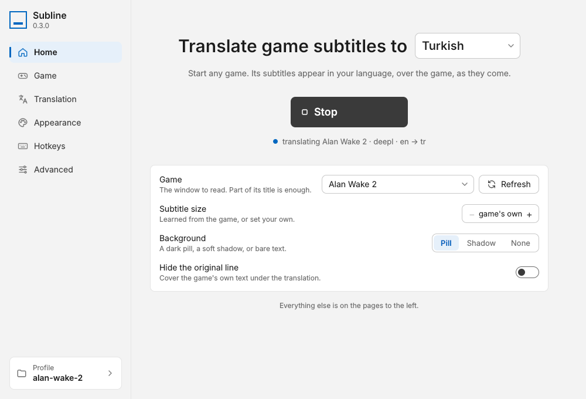

# Subline

Real-time translation of in-game subtitles for Windows.

Subline captures a game window, reads the subtitle area with local OCR,
translates each line through DeepL, Claude or an offline model, and draws
the translation over the game in place of the original, about half a
second after a line appears. The package and the executables are named
`gametl`; the app presents itself as Subline.

Free software under the MIT licence (see [Licensing](#licensing)).


*Alan Wake 2, English to Turkish: the game above, Subline below. Rendered
from a recording by an earlier build (see
[Rendering a demo](#rendering-a-demo)).*

## Contents

- [Features](#features)
- [Requirements](#requirements)
- [Installation](#installation)
- [Getting started](#getting-started)
- [Translators](#translators)
- [Settings](#settings)
- [Command line](#command-line)
- [Rendering a demo](#rendering-a-demo)
- [Architecture](#architecture)
- [Development](#development)
- [Releases](#releases)
- [Acknowledgements](#acknowledgements)
- [Licensing](#licensing)

## Features

- **Works with any windowed or borderless game.** Capture goes through
  Windows Graphics Capture, so only the game window is read, whatever
  else is on screen.
- **Reads the area you choose.** Press a hotkey, drag a rectangle over
  the subtitle strip, and from then on only that strip is read. The choice
  is saved per game as fractions of the window, so it survives resizes;
  a running overlay follows a resize or a change of resolution.
- **Subtitles that look like subtitles.** One fixed size and colour,
  learned from the game's own text, in a font and weight of your choice,
  drawn on a dark pill, with a soft shadow, or bare with an outline,
  centred in the area.
  Long translations wrap at the same size, and lines shown together stack
  instead of overlapping.
- **Three translators.** DeepL (the default: fast, strong for European
  languages, free tier), Claude (glossary, tone notes, any language), or
  an offline CTranslate2 model (no network; an optional download). DeepL
  and Claude both see the recent lines as context, so names and pronouns
  stay consistent across a scene. A faster translator can show a draft
  while a slower one answers.
- **Nothing is translated twice.** A per-game cache answers repeated lines
  instantly, without spending DeepL characters or Claude tokens. For play
  with the Claude translator, a game's script can be translated up front
  in one batch.
- **Settings apply as you change them.** Edits in the settings window
  reach the running overlay as you make them; a new game, language or
  translator restarts it.
- **Stays out of the way.** Tray icon, global hotkeys, per-game profiles
  that load on their own, pause and rescan; the overlay hides when the
  game is not in front.

## Requirements

- Windows 10 (build 18362 or later) or Windows 11, 64-bit.
- The game in windowed or borderless-window mode. Exclusive fullscreen can
  be neither captured nor drawn over.
- For DeepL or Claude, an API key from [deepl.com](https://www.deepl.com/pro-api)
  (the free tier covers 500,000 characters a month) or
  [console.anthropic.com](https://console.anthropic.com/). The offline
  translator needs neither.

## Installation

### Installer

Run `Subline-v<version>-setup.exe` from the release. It installs for the
current user (no administrator prompt) into
`%LOCALAPPDATA%\Programs\Subline`, adds a Start menu entry and, if asked,
a desktop icon, and can start the app when it finishes. Windows SmartScreen
may warn that the publisher is unknown: the installer is not code-signed.
The OCR models (about 20 MB) download on first run into
`%APPDATA%\gametl\models`; Korean, Cyrillic and Arabic text need one more
model, which downloads the first time that OCR language is used.

### Portable build

`gametl-v<version>-win64.zip` is the same app without the installer: unzip
the folder anywhere and run `gametl.exe`.

The folder holds two executables. `gametl.exe` is the tray app: it has no
console and writes its output to `%APPDATA%\gametl\gametl.log`. From a
terminal, use `gametl-cli.exe`: the same app with the same options, its
output in the terminal (and `gametl-cli pretranslate ...` for scripts, see
[Translating a script up front](#translating-a-script-up-front)).

**Uninstall:** Settings > Apps > Subline (or delete the unzipped folder
of the portable build). That removes the program only. Everything else
Subline keeps lives in `%APPDATA%\gametl` (profiles, translation caches,
downloaded models and runtime, `config.json`, the log) and in two Windows
Credential Manager entries (`gametl/DEEPL_AUTH_KEY`,
`gametl/ANTHROPIC_API_KEY`). **Remove all data and quit** on the Advanced
page, or `gametl-cli --remove-all-data`, deletes the folder and the
entries. What versions up to 0.2.1 kept for their licence and trial (two
more entries, `trial_used` in `config.json` and the registry key
`HKEY_CURRENT_USER\Software\Subline`) is removed the first time 0.3 or
later starts. While it runs, Subline keeps a small lock file in `%TEMP%` (`gametl-<id>.lock`),
which goes when it quits.

### From source

Needs [uv](https://docs.astral.sh/uv/).

```
git clone git@github.com:mustafayurdakul/yurdakuls-gameclt.git
cd yurdakuls-gameclt
uv python install 3.12
uv sync
uv run gametl
```

`uv sync --extra offline` adds the offline translator's runtime to a
development install; the packaged app downloads it on demand instead.

## Getting started



1. Run Subline. A tray icon appears and the settings window opens on its
   **Home** page.
2. Once only: paste your DeepL key in the **DeepL key** row on Home and
   press **Save**. The row shows while no key is stored; the
   **Translation** page has the same field, and Claude and the offline
   model are there too. Keys are kept in Windows Credential Manager, never
   in a profile file.
3. On Home, pick the language to translate to and the game window (press
   **Refresh** after launching the game), then press **Start**. While the
   overlay runs the button reads **Stop**, and the line under it says what
   the overlay is doing; while it is off, what to do next. A start that
   fails (no matching window, a missing key) says why in a
   banner at the top of the window. The other pages have the same button
   at the top right.
4. The bottom quarter of the window is read by default. If the subtitles
   sit elsewhere, press **Select on screen** on the **Game** page, or
   **Ctrl+Shift+A** with the game in front, and drag a rectangle over them.
5. Save the settings as a profile from the **Profile** card at the bottom
   left (**Save current as**), so the game is recognised next time.

With the game in front, **Ctrl+Shift+A** selects the area at any time:
drag a rectangle, nudge it with the arrow keys (Shift: 10 px, Ctrl:
resize), Enter confirms, Esc cancels; holding Shift while dragging keeps
the rectangle centred, so one edge and the height are enough. Translations
appear in that area from then on, and the area is saved with the profile.

The pages: **Home** (the target language, the game, Start, and the three
settings a player touches: subtitle size, background and hiding the
original line), **Game** (window, area, what to ignore), **Translation**
(languages, translator, draft, keys; Claude's options and the Anthropic
key show only when Claude is the translator, the offline **Download** only
when the offline model is the translator or the draft), **Appearance**
(size, colour, font, weight, pill or shadow, placement, with a live
preview drawn by the overlay's own painter, to scale for a 1080p game),
**Hotkeys** (click a field and press the keys) and **Advanced** (capture
rate, timing, the translator by name, the data on this computer). The window follows the Windows display scaling, and Tab reaches
every control.

Changes take effect as you make them, on the running overlay too: a typed
value once the typing pauses, and the game window, game name, source
language, glossary, tone notes and Claude model when you press Enter or
leave the field. The area, the filters, the look and most of the timing
reach a running overlay directly; a new window, game name, language,
translator or capture rate restarts it (Claude's options do so only while
Claude is in use).

Next time, run Subline the same way. If the game of a saved profile is
open, that profile loads and the overlay starts at once; otherwise the
last profile used loads into the settings window. Another profile loads
from the **Profile** card or the tray's **Profiles** menu; the bin beside
a profile in the card deletes it, after asking. Running Subline
again while it runs brings up its settings window instead of a second
copy. A click on the tray icon opens the settings window; the right button
opens the menu.

Default hotkeys (changeable on the Hotkeys page):

| Hotkey | Action |
| --- | --- |
| Ctrl+Shift+A | select the area to translate |
| Ctrl+Shift+T | start / stop the overlay |
| Ctrl+Shift+P | pause / resume (hides translations, keeps running) |
| Ctrl+Shift+R | rescan: forget tracked lines and read the screen afresh |
| Ctrl+Shift+S | open settings |

Pause and rescan are held only while the overlay runs, so the same keys
work in other programs while Subline is idle. A hotkey needs Ctrl, Alt or
Win; only F1-F24, Pause, Scroll Lock and Print Screen may stand alone or
with Shift alone.

## Translators

| Translator | Latency per line | Best for |
| --- | --- | --- |
| DeepL (default) | about 0.2 s | Turkish and other European languages |
| Claude Haiku 5.5 | about 0.9 s | glossaries, tone notes, consistency between lines, languages DeepL lacks; `claude-opus-5-5` for the best quality |
| Offline (OPUS-MT) | about 0.02 s | no network; good on short lines, weaker on long ones |

Latencies measured for English to Turkish on a desktop PC. The **Draft**
setting shows the offline or DeepL translation at once and replaces it
when the main translator answers.

DeepL and the offline model receive a subtitle wrapped over two lines as
one sentence, which keeps the word order right, and the overlay wraps
their answer to its own width; Claude keeps the game's line breaks. When
DeepL rejects the key or the month's quota is used up, the status line
says so, and DeepL is asked again after a minute.

### Offline translation

The offline translator is not part of the app itself. **Download** on the
Translation page (shown when Offline is the Service or the Draft), or
`gametl-cli --download-model`, fetches its runtime (CTranslate2 and
SentencePiece, about 20 MB, once) into `%APPDATA%\gametl\runtime` and the
Argos model for the language pair into `%APPDATA%\gametl\models`. A
stronger OPUS-MT model for a pair can be converted once with

```
uv run --with torch --with transformers --with huggingface_hub python scripts/convert_offline_model.py --source en --target tr
```

(about 230 MB; the conversion needs PyTorch, the app does not) and is
preferred when present.

### Translating a script up front

If the game's script can be extracted (a text file with one line per
entry, an `.srt`, a JSON file or a CSV), Claude can translate it once,
beforehand. From source, or with the packaged build:

```
uv run gametl-pretranslate script.txt --game "Fake Game"
gametl-cli pretranslate script.txt --game "Fake Game"
```

This uses Claude Opus 5.5 through the Batches API at half price and waits
up to ten minutes (`--wait 0` submits and exits, `--resume JOBFILE`
collects later, `--sync` uses the normal API at once). The lines go into
the game's Claude cache: they are instant in play while the overlay's
translator is Claude (**Service** on the Translation page), and unused
with DeepL or the offline model. The `--game` name must match the
overlay's game name (the profile's **Game name**, or else the window
title), and `--target-lang` (default `tr`) its target language.

## Settings

Most settings have a command-line equivalent (the hotkeys do not);
`gametl-cli --help` lists them.

- **Ignore patterns** (Game page): regular expressions, one per line,
  case-insensitive. Every new profile starts with one that drops any OCR
  line without a letter, which removes the stray digits OCR sometimes
  reads out of background detail. **Ignore zones** exclude rectangles.
  **Short lines need OCR confidence** (default 90 %) drops one- and
  two-letter lines OCR is unsure about; texts under four letters also
  need a second stable frame.
- **Source language** (Translation page, `--source-lang`): what the
  translator is told the text is in. Empty by default, and then the OCR
  language is used. A code (`de`, `en-US`) or an English name (`German`)
  both work; given a code they do not know, or a script such as
  `cyrillic`, DeepL and Claude detect the language themselves.
- **Render** (Appearance page): `subtitle` draws every line in one style
  centred in the selected area; `inplace` puts each translation on its own
  OCR box in the game's own colours. In subtitle mode the font size and
  the text colour are learned from the game's first lines and then held
  for the session (set a size or a `#RRGGBB` colour to override), and the
  text sits on a steady baseline at the bottom of the area (**Position**
  `bottom`; `source` follows the game's own line; `center` centres it in
  the area). At `bottom` and `center`, lines on screen together, such as a
  speaker line and a prompt, stack in the game's order. The background is
  a `pill` (its opacity below it, in per cent; `--subtitle-pill-alpha`
  takes 0-255), a `shadow` like the game's own text, or `none`. **Hide the
  original line** covers the game's own text when the translation is drawn
  elsewhere; off by default.
- **Font and Weight** (Appearance page): any font installed on the
  computer (default Segoe UI) and a weight from Regular to Bold (default
  SemiBold). The preview on the page is painted by the overlay's own
  code.
- **Only centred text** and **Only subtitle-sized text** (Appearance page)
  keep HUD prompts and objectives that share the area out of the
  subtitles: text whose centre is more than 10 % of the area's width off
  centre, or whose line height differs more than 35 % from the learned
  size, is left alone. Set either to 0 for games that left-align their
  subtitles.
- **Read on the GPU** (Translation page): DirectML on any DirectX 12 card.
  On an RTX 3080 Ti a full 1280x720 frame drops from 204 ms to 105 ms, but
  a subtitle strip goes from 54 ms to 71 ms: leave it off for a strip, turn
  it on for large areas.
- **Change that wakes OCR** (Advanced page, `--change-threshold`): OCR runs
  only when something in the read area has changed since the frame last
  read (the strongest local change in a small grey thumbnail, 0 to 255;
  default 20), so a short word appearing in a wide strip counts in full
  and a static screen costs no OCR. Lower it if a line is ever missed; 0
  reads every frame. A line's translation is requested the first time it
  is seen and shown once a second frame confirms it, so the answer is
  usually there by then.
- **Read the whole window every** (Advanced page, `--full-scan-every`): in
  `inplace` mode with an area set, the rest of the window is read too,
  every N OCR reads; 0 (the default) never. Subtitle mode never does.
- **Keep the overlay out of recordings** (Game page): off by default, so
  recordings, streams and screenshots include the translations. Turn it
  on if a capture tool should not see the overlay.
- **Write the cache every** (Advanced page, `--autosave-seconds`, default
  10 s): how soon new translations reach the cache file.

## Command line

In the packaged build, run these with `gametl-cli` (see
[Packaged build](#packaged-build)); from source, with `uv run gametl`.

`gametl` on its own runs the tray app with the profile of the game that is
open, or the last one used (see [Getting started](#getting-started)).
`gametl --window "Part of the title" --translator deepl` runs on that
window without the tray; `--profile NAME` loads a profile first;
`--tray --window ...` runs with the tray and starts at once;
`--save-profile NAME` saves the resulting settings; `--debug` outlines
every tracked block and prints per-frame timings; `--list-windows` lists
the capturable windows. Options given on the command line override the
profile, or the defaults. A switch turns its setting one way only
(`--hide-source` on, `--no-hide-unfocused` off); a profile's switch is
turned back in the settings window.

## Rendering a demo

Window-capture recorders (Xbox Game Bar, OBS "Game Capture") record the
game window only, so the overlay, a separate window, is not in the
recording even when it is on screen. Use a display capture (OBS "Display
Capture") to record both, or render the overlay onto an existing recording
with the same pipeline the app uses:

```
uv run python scripts/render_demo.py capture.mp4 --start 508 --end 520 --out docs/demo.gif
```

This is also a way to try a game from a recording without running it.

## Architecture

One frame goes through these steps, about ten times a second, on the
pipeline thread (`app/pipeline.py`):

1. `capture/` grabs the game window with Windows Graphics Capture and
   hands over a BGR frame.
2. `ocr/` reads the selected area (or the whole client area) with
   RapidOCR's PP-OCR models on ONNX Runtime and returns text lines with
   pixel boxes. A frame in whose area nothing has changed since the last
   one read (judged on a small grey thumbnail) and whose blocks are all
   settled is not read at all.
3. `tracking/filters.py` drops lines in ignore zones or matching ignore
   patterns; `tracking/blocks.py` groups lines into blocks and matches them
   to the blocks seen in earlier frames, so each block keeps its id, a
   stability count and a few frames of grace when OCR misses it.
4. `translate/service.py` answers from the per-game cache at once and sends
   new text to the translator on a worker thread (with an optional faster
   draft translator); the pipeline never waits for a reply, and a line in
   the cache is never sent again. New translations are written to the
   cache file within seconds; a cache file that cannot be read is set
   aside as `.bad` and the game starts with an empty one.
5. `layout/` decides how a translation is drawn: `style.py` keeps size and
   colours consistent (per band in place; one locked style for the whole
   subtitle zone), `fit.py` wraps and sizes text, `colors.py` samples the
   background and text colours.
6. `overlay/paint.py` paints the result (fonts, layouts; one
   painter shared with the settings preview and the demo renderer) and
   `overlay/window.py` shows it in a click-through window glued to the
   game, in subtitle mode or in place.

`app/controller.py` builds this chain from a `Settings` object and owns it
while it runs; the tray icon, the settings window and the command line are
the three ways of driving it. The slow part of a start (waiting for the
window, loading or downloading models) runs on a thread, so the tray and
the settings window stay responsive; a missing key is reported before any
waiting. Settings edited while a session runs reach the pipeline and the
overlay directly; a change of window, language or translator restarts the
session. When the captured frames change size (a resize, a new
resolution), the area and the zones are worked out again without a
restart.

The settings window is Qt Quick, drawn by its software renderer (a form
needs no GPU, and a Direct3D window opening beside a game can make a
display flicker). The pages are QML files under `app/qml/`, styled by hand
(`Theme.qml` holds the colours and sizes); `app/settings_backend.py` is
what they read and write: a property map with one entry per setting, plus
the actions (start, select an area, save a key, remove all data) that
go to the tray as signals. The window is laid out at 96 dpi and scaled by
the screen's display scaling; the overlay and the area selector work in
physical pixels.

```
src/gametl/
  capture/    window-targeted screen capture (Windows Graphics Capture)
  ocr/        text detection and recognition (RapidOCR on ONNX Runtime)
  tracking/   lines -> blocks, cross-frame matching, stability gate, ignore filters
  translate/  Translator interface, Claude / DeepL / offline backends, cache, service
  layout/     fitting text into the source box, colour sampling, consistent styling
  overlay/    block painter, transparent click-through window, area selector
  app/        controller, pipeline thread, tray icon, settings window (qml/), hotkeys, profiles, API keys
scripts/      fake game, demo renderer, diagnostics, build, model conversion, settings-window renders
tests/
docs/         demo clip, renders of the settings pages (docs/ui)
```

[PLAN.md](PLAN.md) is the design log of the first builds (up to 0.1.0):
the early decisions and the measurements behind them. This README
describes the app as it is now.

## Development

```
uv run pytest
uv run ruff check src tests scripts
uv run ruff format src tests scripts
```

The overlay, selector and hotkey tests need an interactive desktop
session; CI skips them.

CI and the release build install with `uv sync --locked`: after a change
to the dependencies in `pyproject.toml`, run `uv lock` and commit
`uv.lock`, or the jobs fail. opencv-python is no longer installed (only
opencv-python-headless provides `cv2`); in an environment that had both,
`uv sync` removes it and can take shared `cv2` files with it. If
`import cv2` fails afterwards, run
`uv sync --reinstall-package opencv-python-headless`.

- `scripts/fake_game.py` opens a stand-in game window with a HUD and a
  large subtitle that changes every few seconds, so the whole pipeline can
  be tried without a game and without API calls:

  ```
  uv run python scripts/fake_game.py
  uv run gametl --window "Fake Game" --translator verbose --roi 0,0.75,1,0.25
  ```

- `scripts/preview_ui.py --out out/ui` renders every settings page to PNG
  without a display: `--full` makes each page tall enough to show whole,
  `--scale 1.5` renders as on a 150 % screen, `--profiles` adds the open
  Profiles popup and `--translator claude` shows the Claude card. The
  renders in `docs/ui` come from `preview_ui.py --full --profiles --out docs/ui`
  and `--page appearance --full --background shadow --out docs/ui`.
- `gametl --check-ui` (or `python -m gametl.app.settings_window --check`)
  loads every page and popup offscreen and reports QML problems. CI and
  the release workflow run it on the frozen build too
  (`gametl-cli.exe --check-ui`).
- `scripts/spike_capture_ocr.py` captures a window and prints what OCR
  sees, with timings, without the overlay; `--change-threshold` skips the
  frames the app would skip.
- `scripts/bench_translate.py` measures Claude request latency per
  configuration (real API calls).

## Releases

```
uv run --group build python scripts/build.py
```

builds the distributable folder `dist/gametl` with PyInstaller: `gametl.exe`
and `gametl-cli.exe` on one shared runtime; `--installer` also compiles
`installer/subline.iss` with Inno Setup 6 into
`dist/Subline-v<version>-setup.exe`. GitHub Actions
(`.github/workflows/release.yml`) does the same on a Windows runner: bump
`__version__` in `src/gametl/__init__.py` (the one place the version
lives; `pyproject.toml` reads it from there) and merge to `main`, and the
workflow, seeing a version with no tag yet, builds the folder, checks its
settings window with `gametl-cli.exe --check-ui`, creates the tag
`v<version>` at the merge commit and attaches `gametl-v<version>-win64.zip`
to its release. A merge whose version is already tagged builds nothing.
Pushing a tag by hand (a dash, as in `v0.2.0-beta1`, makes a pre-release)
or running the workflow from the Actions tab with a tag name does the
same; with the tag left empty, the workflow builds without releasing and
keeps the zip as a seven-day artifact. The tag must match `__version__`.

The releases of a private repository are visible to its collaborators
only; for customers, publish the zip elsewhere. The executables are not
code-signed, so Windows warns about an unknown publisher until a signing
step is added.

## Acknowledgements

[RapidOCR](https://github.com/RapidAI/RapidOCR) and the PP-OCR models,
[ONNX Runtime](https://onnxruntime.ai/),
[windows-capture](https://github.com/NiiightmareXD/windows-capture),
[CTranslate2](https://github.com/OpenNMT/CTranslate2) with the
[OPUS-MT](https://github.com/Helsinki-NLP/Opus-MT) and
[Argos Translate](https://github.com/argosopentech/argos-translate) models,
[PySide6](https://doc.qt.io/qtforpython-6/), and the DeepL and Anthropic
APIs.

## Licensing

Subline (gametl) is free software, copyright (c) 2026 Mustafa Yurdakul,
under the [MIT licence](LICENSE). The open-source components it bundles
or downloads are listed with their licences in
[THIRD_PARTY_NOTICES.md](THIRD_PARTY_NOTICES.md).
