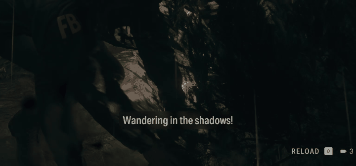

# gametl

Copyright (c) 2026 Mustafa Yurdakul. Proprietary software: free to try for
14 days, then a licence key is needed (see [Licence](#licence)).

Real-time translation of in-game subtitles for Windows. gametl captures a
game window, reads the subtitle area with local OCR, translates each line
(DeepL, Claude, or an offline model), and draws the translation over the
game in place of the original, about half a second after a line appears.



*Alan Wake 2, English to Turkish. Rendered from a recording with the same
pipeline the live overlay uses (see [Recording a demo](#recording-a-demo)).*

## What it does

- **Any game that runs windowed or borderless.** Capture goes through
  Windows Graphics Capture, so the game window alone is read, whatever
  else is on screen.
- **You choose the area.** Press a hotkey, drag a rectangle over the
  subtitle strip, and from then on only that strip is read. The choice is
  saved per game as fractions of the window.
- **Subtitles look like subtitles.** One fixed size and colour, outlined,
  on a dark pill centred in the area, placed on the line the game drew.
  Long translations wrap at the same size.
- **Three translators.** DeepL (fast, strong for European languages,
  free tier), Claude (glossary, tone notes, context between lines, any
  language), or an offline CTranslate2 model (no network at all). A faster
  translator can show a draft while a slower one answers.
- **Nothing is translated twice.** A per-game cache answers repeated lines
  instantly; a game's script can be pre-translated in one batch.
- **Stays out of the way.** Tray icon, global hotkeys, per-game profiles,
  pause and rescan, hides when the game is not in front.

## Requirements

- Windows 10 (build 18362 or later) or Windows 11.
- The game in windowed or borderless-window mode (exclusive fullscreen
  cannot be captured or drawn over).
- For DeepL or Claude: an API key from [deepl.com](https://www.deepl.com/pro-api)
  (free tier: 500k characters a month) or
  [console.anthropic.com](https://console.anthropic.com/). The offline
  translator needs neither.

## Install

**Packaged build:** unzip the release folder anywhere and run `gametl.exe`.
The OCR models (about 20 MB) download on first run into
`%APPDATA%\gametl\models`. The app runs as a 14-day trial until a licence
key is entered on the Licence tab. To build the folder yourself from a
checkout:

```
uv run --group build python scripts/build.py
```

**From source**, for licensed use (needs [uv](https://docs.astral.sh/uv/)):

```
git clone git@github.com:mustafayurdakul/yurdakuls-gameclt.git
cd yurdakuls-gameclt
uv python install 3.12
uv sync
uv run gametl
```

## Quick start

1. Run gametl. A tray icon appears and the settings window opens.
2. On the **Translation** tab, paste your DeepL or Anthropic key into its
   field and press Save. Keys are kept in Windows Credential Manager, never
   in a profile file. Pick the translator and the target language.
3. On the **Game** tab, pick the game window from the list (Refresh after
   launching the game), then **Apply and run** and **Save profile**.
4. With the game in front, press **Ctrl+Shift+A** and drag a rectangle over
   the subtitle area. The rectangle stays centred while you drag, so one
   edge and the height are enough. Translations appear in that area from
   then on, and the area is saved with the profile.

Next time, start the game from the tray's Profiles menu.

The **Licence** tab shows how many trial days are left; paste your key
there and press Activate. The key is kept in Windows Credential Manager.
From the command line, `gametl --activate KEY` stores a key and
`gametl --license-status` prints the state.

Default hotkeys (changeable on the Hotkeys tab):

| Hotkey | Action |
| --- | --- |
| Ctrl+Shift+A | select the area to translate (Esc cancels) |
| Ctrl+Shift+T | start / stop the overlay |
| Ctrl+Shift+P | pause / resume (hides translations, keeps running) |
| Ctrl+Shift+R | rescan: forget tracked lines and read the screen afresh |
| Ctrl+Shift+S | open settings |

## Choosing a translator

| Translator | Latency per line | Best for |
| --- | --- | --- |
| DeepL | about 0.2 s | Turkish and other European languages; the recommended default when a key is at hand |
| Claude Haiku 5.5 | about 0.9 s | glossaries, tone notes, consistency between lines, languages DeepL lacks; `claude-opus-5-5` for quality |
| Offline (OPUS-MT) | about 0.02 s | no network; good short lines, weaker on long ones |

Latencies measured from this machine for English to Turkish. Use the
**Draft** setting to show the offline or DeepL translation at once and
replace it when the main translator answers.

The offline models live under `%APPDATA%\gametl\models`: the OPUS-MT model
for a pair, converted once with
`uv run --with torch --with transformers --with huggingface_hub python scripts/convert_offline_model.py --source en --target tr`
(about 230 MB; the conversion needs PyTorch, the app does not), or the
smaller and weaker Argos package from the "Download offline model" button.

If the game's script can be extracted (a text file with one line per
entry, an .srt, a JSON file or a CSV), translate it once up front so every
line is instant in play:

```
uv run gametl-pretranslate script.txt --game "Fake Game"
```

This uses Opus 5.5 through the Batches API at half price and waits up to
ten minutes (`--wait 0` submits and exits, `--resume JOBFILE` collects
later, `--sync` uses the normal API at once). The `--game` name must match
the one the overlay runs with.

## Settings worth knowing

- **Ignore patterns** (Game tab): regular expressions, one per line,
  case-insensitive. Every new profile starts with one that drops any OCR
  line without a letter, which removes the stray digits OCR sometimes
  reads out of background detail. **Ignore zones** exclude rectangles.
- **Render** (Appearance tab): `subtitle` draws one pill centred in the
  selected area; `inplace` puts each translation on its own OCR box in the
  game's own colours. Font size, colour, background and position of the
  subtitle are below it.
- **Run OCR on the GPU** (Translation tab): DirectML on any DirectX 12
  card. Measured on an RTX 3080 Ti, a full 1280x720 frame drops from 204 ms
  to 105 ms, but a subtitle strip goes from 54 ms to 71 ms, so leave it off
  for a strip and turn it on for large areas.
- **Keep the overlay out of screen recordings** (Game tab): off by default,
  so recordings, streams and screenshots include the translations. Turn it
  on if a capture tool should not see the overlay.

Every setting has a command-line equivalent; `gametl --help` lists them.
`gametl --window "Part of the title" --translator deepl` runs without the
tray, `--profile NAME` loads a profile, and `--debug` outlines every tracked
block and prints per-frame timings.

## Recording a demo

Window-capture recorders (Xbox Game Bar, OBS "Game Capture") record the
game window only, so the overlay, a separate window, is not in the
recording even when it is on screen. Use a display capture (OBS "Display
Capture") to record both, or render the overlay onto an existing recording
with the same pipeline the app uses:

```
uv run python scripts/render_demo.py capture.mp4 --start 508 --end 520 --out docs/demo.gif
```

This is also a way to try a game from a recording without running it.

## How it fits together

One frame goes through these steps, about ten times a second, on the
pipeline thread (`app/pipeline.py`):

1. `capture/` grabs the game window with Windows Graphics Capture and
   hands over a BGR frame plus the window's screen rectangle.
2. `ocr/` reads the selected area (or the whole client area) with
   RapidOCR's PP-OCR models on ONNX Runtime and returns text lines with
   pixel boxes.
3. `tracking/filters.py` drops lines in ignore zones or matching ignore
   patterns; `tracking/blocks.py` groups lines into blocks and matches them
   to the blocks seen in earlier frames, so each block keeps its id, a
   stability count and a few frames of grace when OCR misses it.
4. `translate/service.py` answers from the per-game cache at once and sends
   new text to the translator on a worker thread (with an optional faster
   draft translator); the pipeline never waits for a reply.
5. `layout/` decides how a translation is drawn: `style.py` keeps size and
   colours consistent across lines in the same band, `fit.py` wraps and
   sizes text, `colors.py` samples the background and text colours.
6. `overlay/window.py` draws the result in a click-through window glued to
   the game, in subtitle mode or in place.

`app/controller.py` builds this chain from a `Settings` object and owns it
while it runs; the tray icon, the settings window and the command line are
the three ways of driving it. `app/credentials.py` finds API keys.

```
src/gametl/
  capture/    window-targeted screen capture (Windows Graphics Capture)
  ocr/        text detection and recognition (RapidOCR on ONNX Runtime)
  tracking/   lines -> blocks, cross-frame matching, stability gate, ignore filters
  translate/  Translator interface, Claude / DeepL / offline backends, cache, service
  layout/     fitting text into the source box, colour sampling, consistent styling
  overlay/    transparent click-through window, area selector
  app/        controller, pipeline thread, tray icon, settings window, hotkeys, profiles, API keys
scripts/      fake game, demo renderer, diagnostics, build, model conversion
tests/
docs/         demo clip
```

[PLAN.md](PLAN.md) is the design document and the log of every decision and
measurement made along the way.

## Development

```
uv run pytest
uv run ruff check src tests scripts
uv run ruff format src tests scripts
```

`scripts/fake_game.py` opens a stand-in game window with a HUD and a large
subtitle that changes every few seconds, so the whole pipeline can be tried
without a game and without API calls:

```
uv run python scripts/fake_game.py
uv run gametl --window "Fake Game" --translator verbose --roi 0,0.75,1,0.25
```

`scripts/spike_capture_ocr.py` captures a window and prints what OCR sees,
with timings, without the overlay. `scripts/bench_translate.py` measures
Claude request latency per configuration (real API calls).
`scripts/make_license.py` issues licence keys; it needs the private signing
key, which is not in the repository.

## Acknowledgements

[RapidOCR](https://github.com/RapidAI/RapidOCR) and the PP-OCR models,
[ONNX Runtime](https://onnxruntime.ai/),
[windows-capture](https://github.com/NiiightmareXD/windows-capture),
[CTranslate2](https://github.com/OpenNMT/CTranslate2) with the
[OPUS-MT](https://github.com/Helsinki-NLP/Opus-MT) and
[Argos Translate](https://github.com/argosopentech/argos-translate) models,
[PySide6](https://doc.qt.io/qtforpython-6/), and the DeepL and Anthropic
APIs.

## Licence

gametl is proprietary software, copyright (c) 2026 Mustafa Yurdakul. It may
be used for a 14-day trial, after which a licence key bought from the
author is required; see [LICENSE](LICENSE) for the terms. The open-source
components it bundles are listed with their licences in
[THIRD_PARTY_NOTICES.md](THIRD_PARTY_NOTICES.md). Licence enquiries:
mustafa@yurdakul.dev.
